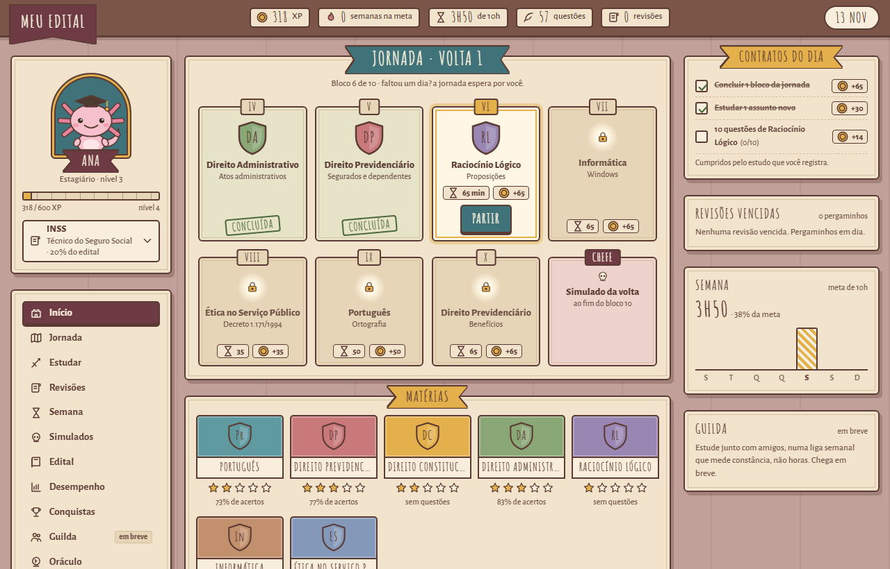
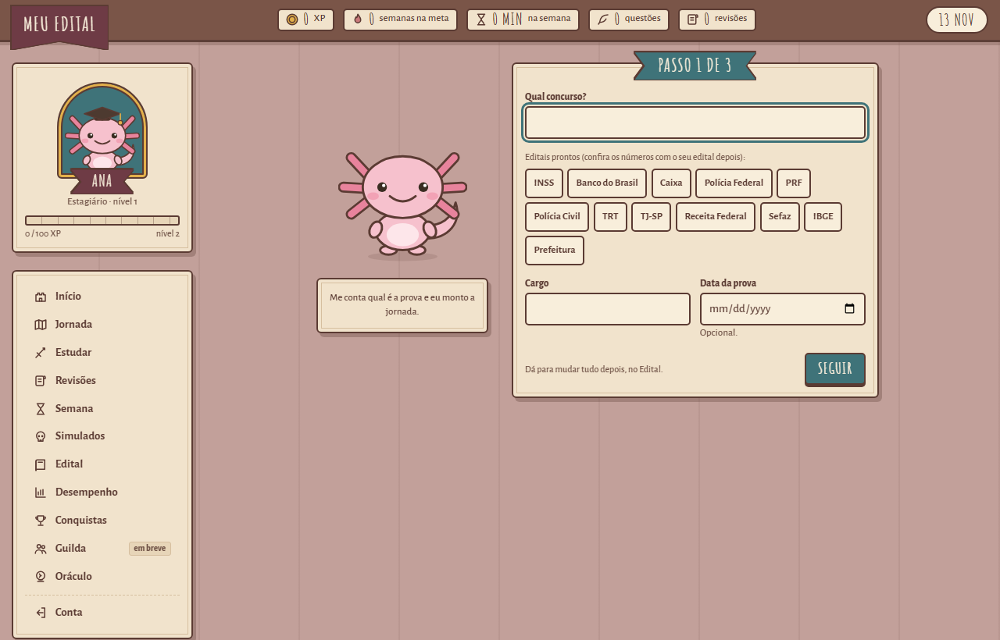
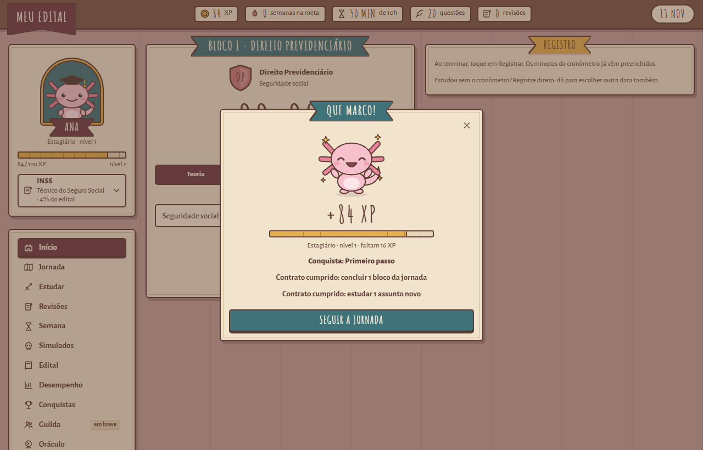
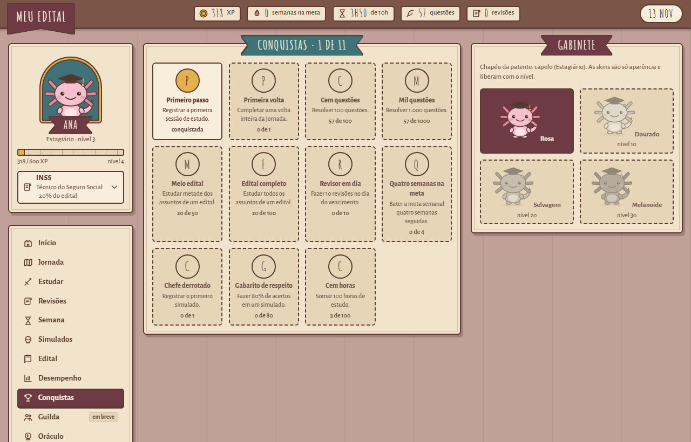
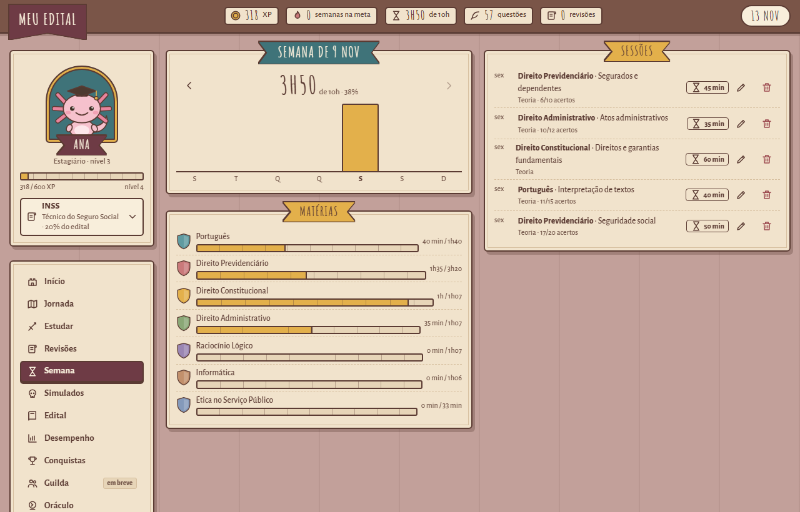
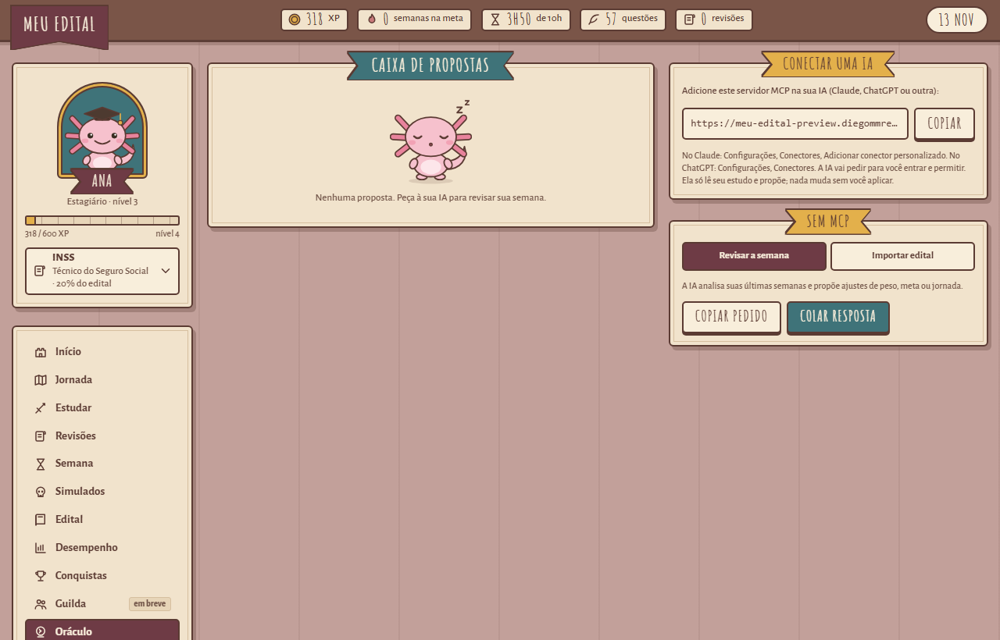
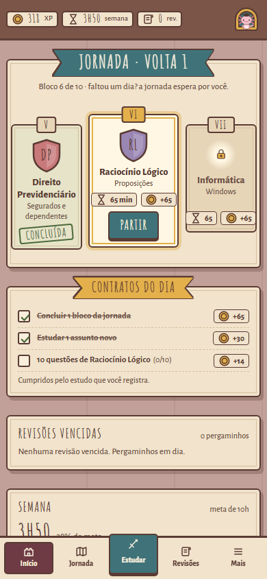
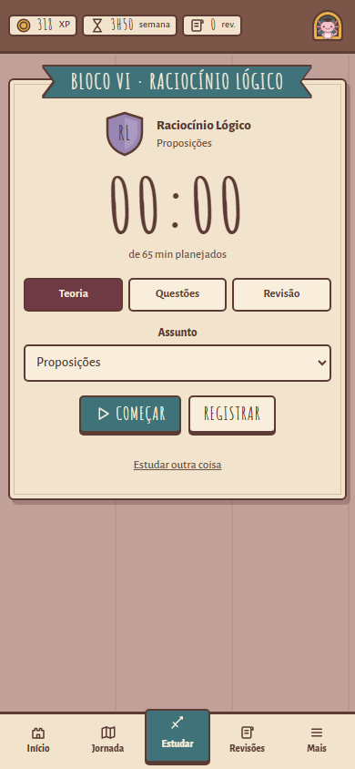

# Meu Edital

**Seu edital tem 12 matérias. Hoje você estuda qual?**

Um app gratuito de estudos para concursos públicos que monta uma jornada pelos pesos do edital e mostra sempre o próximo bloco. Faltou um dia? A jornada espera por você.

[**Começar minha jornada**](https://meu-edital.diegommrez12.workers.dev/?conta=criar) · [Conhecer o app](https://meu-edital-site.diegommrez12.workers.dev)

  

## Por que um ciclo, e não um cronograma

O cronograma dia a dia quebra na primeira falta: perdeu a terça e a semana inteira desanda. No Meu Edital você estuda em **ciclo**. As matérias viram uma fila de blocos com o tempo de cada uma calculado pelo peso no edital. Você estuda o próximo bloco quando puder, e uma volta completa soma a sua meta da semana.

- **Sempre sabe o que estudar agora.** O app mostra o próximo bloco e sugere o assunto.
- **A matéria que mais pesa recebe mais tempo**, sem conta de cabeça.
- **Revisões no tempo certo.** Depois de estudar um assunto, ele volta para revisão em 1, 7 e 30 dias.
- **A semana em um olhar.** O tempo estudado contra a meta, por matéria e por dia.

## Do edital ao primeiro bloco em três passos

  

1. **Escolha o concurso.** Há editais prontos dos concursos mais procurados, ou monte o seu em um minuto.
2. **Diga quantas horas por semana você tem.**
3. **Parta para o primeiro bloco.** Aperte play no cronômetro ou registre o estudo depois.

## Estudar vira jogo

Só estudo de verdade dá recompensa: abrir o app e clicar em botão não rende nada.

  

- **XP e patente.** Cada minuto e cada acerto contam, de Estagiário a Ministro.
- **Contratos do dia.** Três missões tiradas do que você mais precisa, cumpridas estudando.
- **Ofensiva semanal.** Conta semanas na meta, não dias. Faltar um dia não pune.
- **Chefe da volta.** Fechou a jornada? Um simulado mede a sua força.
- **Conquistas e visuais** para o mascote, liberados com o nível.

  

## Acompanhe a semana

  

Veja quanto estudou em cada dia e em cada matéria, corrija ou apague uma sessão, e confira o desempenho e o aproveitamento nas questões.

## O Oráculo: a sua IA como conselheira

Conecte a IA que você já usa (Claude, ChatGPT ou outra) ao seu estudo. Ela lê como foi a sua semana e propõe ajustes de peso, meta e jornada. **Nada muda sem você aprovar**: cada proposta aparece com o antes e o depois.

  

## No celular também

  
  &nbsp;&nbsp;
  

O app funciona no navegador do computador e do celular, e continua funcionando sem internet: o estudo fica salvo no aparelho e sincroniza quando a conexão volta. Um app para Android está a caminho.

## Perguntas rápidas

**É grátis?** Sim. Sem cartão e sem período de teste.

**Ainda não saiu o edital. Dá para usar?** Dá. Comece pelo edital anterior e ajuste quando o novo sair.

**E os meus dados?** São seus. Dá para baixar tudo e excluir a conta a qualquer hora. Leia a [política de privacidade](https://meu-edital-site.diegommrez12.workers.dev/privacidade/).

## Software livre

O Meu Edital é software livre, sob a licença [GNU AGPL versão 3](LICENSE). Quer contribuir ou rodar o projeto na sua máquina? Veja o [guia de desenvolvimento](docs/desenvolvimento.md).
